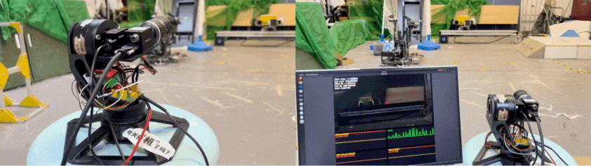
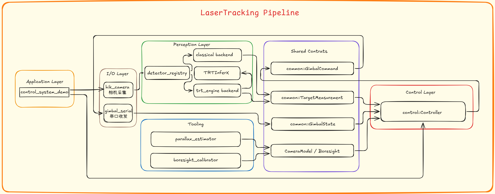

# LaserTracking

YSU 使用的视觉激光追踪项目，面向 RoboMaster 2026 反无人机激光追踪系统。项目将工业相机、目标检测、云台控制和串口通信拆分为可独立维护的 C++ 模块。

- 原始方案介绍：[RoboMaster 论坛开源帖](https://bbs.robomaster.com/article/1883301?source=1)

## 项目效果

<p align="center">
  
  <br><em>目标搜索与追踪演示</em>
</p>

该代码库用于原型验证和系统集成。实际参赛方案已在此基础上继续改进，检测模型、镜头、相机帧率和控制参数都需要按现场设备重新调试。

## 系统架构

<p align="center">
  
</p>

| 模块 | 作用 |
| --- | --- |
| `common` | 共享测量、云台状态、控制指令、相机模型和配置读取接口 |
| `hik_camera` | 海康 MVS 工业相机驱动，输出图像帧；支持 CPU 和可选 CUDA/NPP 图像处理 |
| `detector` | 传统视觉或 TensorRT 检测后端，输出统一的目标测量结果 |
| `control` | 将图像误差转换为云台角度指令；支持目标丢失后的搜索轨迹 |
| `gimbal_serial` | 云台串口协议的收发与状态解析 |
| `tool/boresight_calibrator` | 标定相机与激光的图像坐标偏置 `u_L/v_L` |
| `tool/parallax_estimator` | 估算不同目标距离下的相机与激光视差 |
| `yolo` | YOLO 数据处理、训练和模型导出脚本及训练记录 |

## 目录结构

```text
.
├── docs/                         # 图片、演示与硬件资料
├── src/
│   ├── common/                   # 共享类型与配置读取
│   ├── control/                  # 控制器、配置与系统示例
│   ├── detector/                 # 传统视觉、TensorRT 和模型说明
│   ├── gimbal_serial/            # 云台串口通信
│   ├── hik_camera/               # 海康相机驱动与配置
│   └── tool/                     # 校准和视差工具
├── yolo/                         # 训练与数据转换脚本
├── build.sh                      # 本地构建快捷脚本
└── calibrator.sh                 # 同轴校准工具启动脚本
```

训练数据集、编译目录、运行日志和本地 TensorRT 引擎不会作为项目源码提交。模型获取说明见 [`src/detector/model/README.md`](src/detector/model/README.md)。

## 环境依赖

- Ubuntu 22.04（推荐）、C++17 编译器、CMake 3.18 或更新版本
- OpenCV 4
- 海康 MVS SDK：完整相机与系统串联构建需要；默认安装位置为 `/opt/MVS`
- CUDA Toolkit 与 TensorRT：启用 TensorRT 检测后端时需要
- CUDA/NPP：相机 GPU 图像处理的可选依赖

TensorRT 引擎与 GPU 型号、CUDA 和 TensorRT 版本相关。若本机没有匹配的引擎，请使用发布的 ONNX 模型重新生成引擎。检测模型不随 Git 仓库提供。

## 构建

### 完整构建

安装 OpenCV、海康 MVS SDK、CUDA 和 TensorRT 后，在项目根目录执行：

```bash
cmake -S src -B src/build_full_auto \
  -DMVS_ROOT=/opt/MVS \
  -DDETECTOR_WITH_TRT=ON
cmake --build src/build_full_auto -j"$(nproc)"
```

若 CUDA 或 TensorRT 不在系统默认路径，可按需传入安装位置：

```bash
-DTRT_INCLUDE_DIR=/path/to/TensorRT/include \
-DTRT_LIB_DIR=/path/to/TensorRT/lib
```

### 使用传统视觉后端

不使用 TensorRT 时，关闭 TensorRT 和相机 CUDA/NPP 支持：

```bash
cmake -S src -B src/build_cpu \
  -DMVS_ROOT=/opt/MVS \
  -DDETECTOR_WITH_TRT=OFF \
  -DHIK_CAMERA_ENABLE_CUDA=OFF \
  -DHIK_CAMERA_ENABLE_NPP=OFF
cmake --build src/build_cpu -j"$(nproc)"
```

同时将 `src/detector/config/detector.yaml` 中的 `backend` 改为 `classical`。完整系统仍使用海康相机，因此需要安装 MVS SDK。

构建后的主要程序位于：

- `src/build_full_auto/control/control_system_demo`
- `src/build_full_auto/detector/detector_demo`
- `src/build_full_auto/detector/detector_hik_demo`
- `src/build_full_auto/gimbal_serial/gimbal_serial_demo`
- `src/build_full_auto/tool/boresight_calibrator/boresight_calibrator`
- `src/build_full_auto/tool/parallax_estimator/parallax_demo`

## 运行系统

先按实际设备修改相机、检测、控制和串口配置，然后启动控制串联程序：

```bash
cd src/build_full_auto/control
./control_system_demo \
  --camera-config ../../hik_camera/config/config.yaml \
  --detector-config ../../detector/config/detector.yaml \
  --control-config ../../control/config/control.yaml \
  --port /dev/ttyACM0 \
  --baud 115200 \
  --send-hz 400
```

串口名、波特率和发送频率应与电控端设置一致。确认云台方向符号和机械限位后再进行闭环测试；角度约定和串口帧字段见 [`src/control/README.md`](src/control/README.md) 与 [`src/gimbal_serial/README.md`](src/gimbal_serial/README.md)。

控制程序运行日志写入 `src/log/log.txt`，此目录已被 Git 忽略。

## 配置与校准

| 配置文件 | 说明 |
| --- | --- |
| `src/hik_camera/config/config.yaml` | 相机采集、曝光、ROI、去畸变及缓冲参数 |
| `src/detector/config/detector.yaml` | 检测后端选择 |
| `src/detector/classical/config/classical.yaml` | 传统视觉检测与跟踪参数 |
| `src/detector/trt_engine/config/trt.yaml` | TensorRT 引擎路径和后处理参数 |
| `src/control/config/control.yaml` | 控制增益、搜索策略、相机内参与 boresight 坐标 |
| `src/control/config/control_fast_follow.yaml` | 增量式快速跟随参数示例 |

推荐的调试顺序：先使用静止目标确认 `yaw_sign`、`pitch_sign` 和串口通信，再调整控制增益。相机与激光的相对位置会导致视差随距离变化，建议在常用工作距离校准。

校准工具启动方式：

```bash
./calibrator.sh
```

该脚本默认查找 `src/build_full_auto` 下的可执行文件。详细操作见 [`src/tool/boresight_calibrator/README.md`](src/tool/boresight_calibrator/README.md)；视差估算见 [`src/tool/parallax_estimator/README.md`](src/tool/parallax_estimator/README.md)。

## 硬件参考

- 工业相机：Hikrobot MV-CS016
- 云台电机：4310 电机 × 2
- 云台：两轴 Pan-Tilt，电控与机械参数按当前 YSU 方案配置
- 主机：x86_64 Linux；NVIDIA GPU 用于可选 CUDA/TensorRT 加速
- 接口：相机接口和云台通信参数按实际设备配置

相机分辨率、Bayer 格式和帧率应按 MV-CS016 的实际配置核对，并与相机配置及标定参数保持一致。实际应用请使用 RoboMaster 组委会认可的激光发射器。`docs/` 中部分硬件图片和手册是早期方案的参考资料，不代表当前 YSU 硬件配置。

## 相关模块文档

- [相机驱动](src/hik_camera/README.md)
- [目标检测](src/detector/README.md)
- [云台控制](src/control/README.md)
- [串口协议](src/gimbal_serial/README.md)
- [工具说明](src/tool/README.md)
- [模型与发布资源](src/detector/model/README.md)

## 许可

本项目主要源码依据 [GNU Affero General Public License v3.0](LICENSE) 发布。部分第三方组件或随附资料可能有各自的许可条款，请以其目录中的说明为准。
